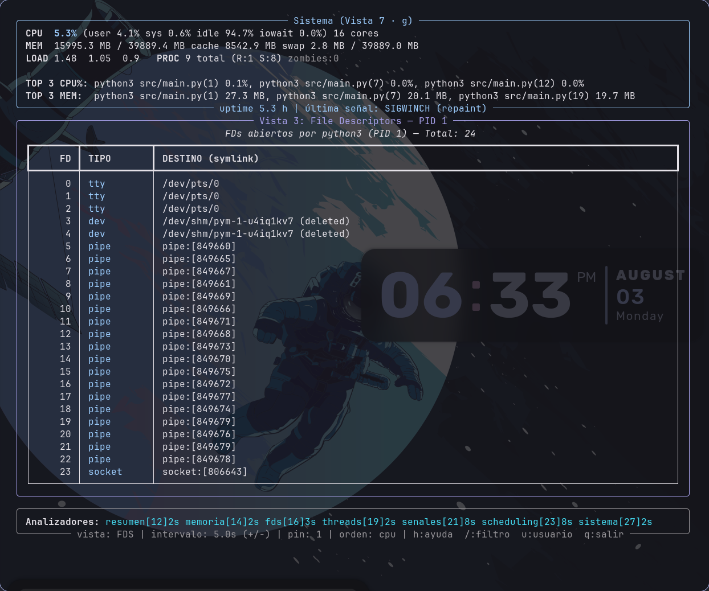
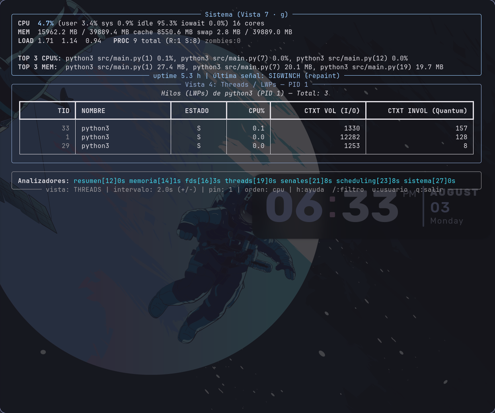
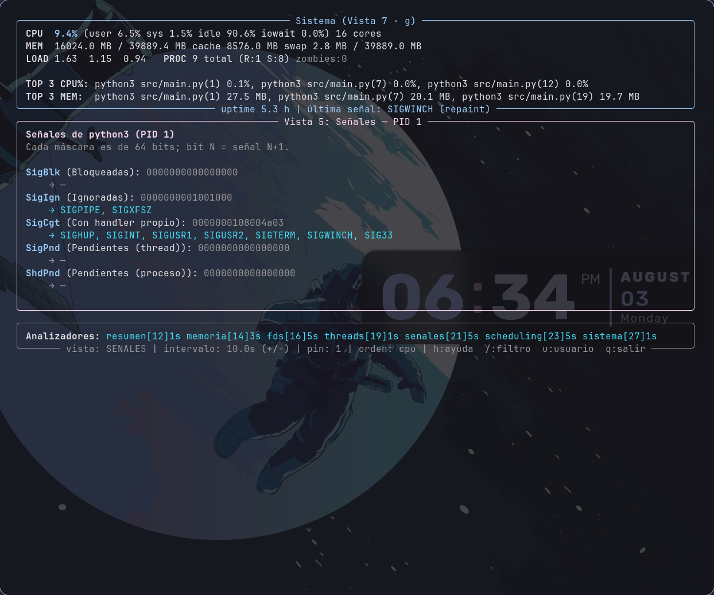
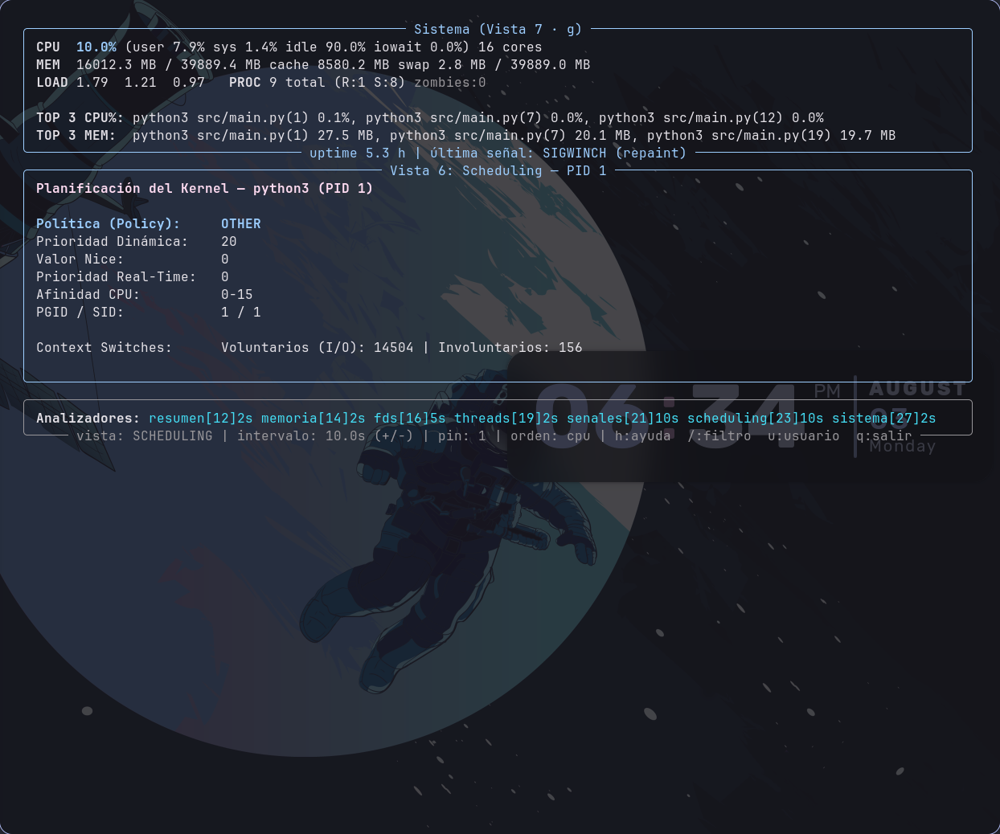

# Monitor de Procesos y Threads — TP1 Computación II

Monitor del sistema en tiempo real (estilo `htop`) que muestra la **anatomía
interna** de cada proceso y sus threads, leyendo **`/proc` a mano** (sin `psutil`).
Es un **sistema multiproceso**: 7 analizadores independientes corren en paralelo,
escriben a un snapshot en memoria compartida, y una TUI (`rich`) muestra 7 vistas
navegables.

---

## 1. Descripción general

El monitor extrae, para cada proceso del sistema, su estado, uso de CPU, memoria,
file descriptors, threads (LWPs), señales y configuración de scheduling —todo
parseando `/proc/<pid>/...` directamente— y lo presenta en una interfaz de terminal
interactiva con 7 vistas alternables por teclado.

La arquitectura es **multiproceso**: cada dimensión (resumen, memoria, fds,
threads, señales, scheduling, sistema) la calcula un **proceso independiente** con
su propio intervalo de refresco. Los procesos se comunican por **memoria
compartida** (`multiprocessing.Manager` y `Value`). El monitor también responde a
señales POSIX (shutdown limpio, recarga de config, dump del estado, verbose).

---

## Capturas de pantalla

| Vista | Captura |
|---|---|
| 1: Resumen (+ header Sistema) |  |
| 2: Memoria (+ header Sistema) |  |
| 3: File Descriptors |  |
| 4: Threads / LWPs |  |
| 5: Señales |  |
| 6: Scheduling |  |

> El panel de arriba (CPU/MEM/LOAD) se ve en todas las capturas porque es un
> header permanente (ver nota en §10, Limitaciones conocidas).

---

## 2. Cómo correr y testear

### Construir y levantar

```bash
docker compose up --build        # buildea la imagen y levanta el servicio
```

### Usar la TUI interactiva (recomendado)

```bash
docker compose run --rm monitor  # TTY real: teclado responde, sin parpadeo
```

> **Por qué `run` y no `up` para interactuar:** `docker compose up` multiplexa la
> salida como *logs* (prefijo `monitor-1 |`) y **no conecta el teclado (stdin)** al
> contenedor, aunque el `docker-compose.yml` tenga `tty: true` y `stdin_open: true`.
> Para una app de terminal interactiva, el modo correcto de Docker es `run` (o
> `docker run -it`), que provee un TTY conectado a tu terminal. Ambos comandos usan
> el mismo `docker-compose.yml`.

### Probar las señales (desde otra terminal)

```bash
docker compose run --rm --name mon1 monitor      # terminal 1
docker exec mon1 sh -c "kill -HUP  1"            # recarga config.json
docker exec mon1 sh -c "kill -USR1 1"            # dump del snapshot a dump_<ts>.json
docker exec mon1 sh -c "kill -USR2 1"            # toggle verbose
docker exec mon1 sh -c "kill -TERM 1"            # shutdown limpio
docker exec -it mon1 sh                          # shell interactiva DENTRO del mismo contenedor
```

> La shell interactiva (`docker exec -it mon1 sh`) sirve para explorar `/proc`
> en el mismo namespace que el monitor, o para generar carga de prueba (ej.
> lanzar varios procesos de fondo y ver el scroll de la Vista 1 en acción).

### Correr los tests

```bash
docker compose run --rm --build monitor \
  sh -c "PYTHONPATH=src python3 -m unittest discover -s tests -p 'test_*.py' -v"
```

37 tests unitarios (parseo de `/proc` con archivos de muestra, cálculo de CPU%,
self-pipe de señales, robustez, filtrado/orden, decodificación de máscaras).

---

## 3. Diagrama de arquitectura

```
                     ┌───────────────────────────────────────────┐
                     │        SNAPSHOT GLOBAL  (Manager.dict)      │
                     │   { "resumen":  {datos, ts, pid},           │
                     │     "memoria":  {datos, ts, pid},           │
                     │     "fds":      {datos, ts, pid},           │
                     │     "threads":  {datos, ts, pid},           │
                     │     "senales":  {datos, ts, pid},           │
                     │     "scheduling": {datos, ts, pid},         │
                     │     "sistema":  {datos, ts, pid} }          │
                     └──▲───▲───▲───▲───▲───▲───▲──────────┬───────┘
       escriben (bajo Lock) │   │   │   │   │   │          │ lee 1 vez por refresco
        ┌──────────┬────────┼───┼───┼───┼───┼───┼──┐       │
    ┌───┴────┐ ┌───┴───┐  ┌─┴─┐ … (7 procesos)      │   ┌───▼──────────┐
    │resumen │ │memoria│  │fds│                      │   │  DISPLAY     │
    │ 2s     │ │ 3s    │  │5s │  cada uno su ritmo    │   │  (proceso    │
    └────────┘ └───────┘  └───┘  (Value por vista)    │   │   principal) │
         ▲          ▲                                 │   │  TUI rich +  │
         │ +/- ajustan el Value del intervalo ────────┘   │  hilo teclado│
                                                          │  + señales   │
                                          self-pipe ──────┤  (self-pipe) │
                                          SIGINT/TERM/HUP/ └──────────────┘
                                          USR1/USR2/WINCH
```

Total: **9 procesos** — el display (principal) + el proceso servidor del `Manager`
+ los 7 analizadores. Dentro del display hay 3 threads (principal, teclado, refresco
de `rich`), permitido por la consigna solo para la entrada de teclado.

### Componentes

| Componente | Responsabilidad |
|------------|-----------------|
| **`procfs.py` / `procfs_sistema.py`** | Único lugar que abre `/proc`; parsea por proceso y global. |
| **7 analizadores** (`analizadores/`) | Cada uno, en su proceso, extrae su dimensión y la escribe al snapshot a su intervalo. |
| **`recolector.py`** | Clase `Recolector`: arma la lista de procesos y calcula CPU% por delta de jiffies (la usan resumen y sistema). |
| **Snapshot** (`Manager.dict`) | Estado global compartido; cada analizador es dueño de su clave. |
| **`display.py` / `vistas.py`** | TUI con `rich`: 7 vistas, navegación, filtros, orden; lee el snapshot. |
| **`senales.py`** | `GestorSenales`: captura señales con patrón self-pipe. |

---

## 4. Decisiones de diseño (argumentadas)

### ¿Por qué `Manager.dict` y no un `dict` normal?

Un `dict` normal vive en la memoria de un proceso; al hacer `fork`, el hijo obtiene
una **copia** y sus cambios no se ven en el padre. El `Manager().dict()` levanta un
**proceso servidor** dueño del dict; los demás lo acceden por un **proxy** vía IPC,
así todos ven lo mismo. Es lo que permite que 7 analizadores escriban y el display
lea.

### ¿Dónde están el "Recolector" y el "Agregador" de la consigna?

La consigna lista 5 componentes, incluyendo un **Recolector** ("lista procesos,
distribuye trabajo a los analizadores") y un **Agregador** ("mantiene el
snapshot global"). En este código no son procesos aparte — están **disueltos**
en las otras dos piezas, y explico por qué:

- **Recolector → una clase reutilizable, no un proceso propio.** `recolector.py`
  define `Recolector`, que arma la lista de `/proc` y calcula el delta de
  jiffies para el CPU%. Pero en vez de un único proceso central que reparta
  trabajo a los otros 6, cada analizador que lo necesita (`resumen.py`,
  `sistema.py`) **instancia su propia copia** (`rec = Recolector()`) y recorre
  `/proc` por su cuenta. Elegí esto porque un recolector central *distribuyendo*
  trabajo forzaría a sincronizar a los 7 analizadores contra una sola fuente
  (perdiendo la independencia de matar uno sin afectar a los demás), y listar
  `/proc` varias veces es barato (es un `tmpfs` en RAM, no disco). Detalle
  ampliado en `dudas.md` punto 4.
- **Agregador → el propio `Manager.dict()`, sin proceso ni lógica extra.** No
  hay una clase ni un proceso que "agregue" datos: cada uno de los 7
  analizadores escribe **directamente** su propia clave del snapshot
  (`base.py:47`, `snapshot[nombre] = entrada`). No hace falta combinar ni
  fusionar nada porque cada clave tiene un único dueño que nunca pisa la de
  otro (mismo argumento que la tabla de race conditions de la Fase 8). El
  servidor que levanta `Manager()` ya resuelve el problema de IPC por sí solo
  (Cap. 4.2 de la guía de estudio); agregar un proceso "agregador" encima solo
  sumaría una capa sin trabajo real que hacer.

En criollo: la consigna describe 5 *responsabilidades*, y las cumplo todas —
pero dos de ellas (recolectar y agregar) no necesitan ser procesos dedicados
porque quedan resueltas por diseño: recolectar es una función que cada
analizador llama, agregar es gratis gracias al `Manager.dict`.

### ¿Por qué `Manager` para el snapshot y `Value` para el intervalo?

Cada herramienta para lo suyo:
- El **snapshot** es una estructura **anidada y de tamaño variable** (listas de
  dicts por proceso) → `Manager.dict`, que serializa objetos arbitrarios.
- El **intervalo** es **un solo número** (double) → `Value('d')`, que usa memoria
  compartida cruda (mmap) sin overhead de IPC. El `+/-` lo escribe y el analizador
  lo lee en cada vuelta de su loop → ajuste **en caliente** sin reiniciar.

### ¿Cómo manejo las race conditions?

Audité los accesos compartidos: cada analizador es **dueño de su clave** (nadie
escribe la misma), las operaciones del `Manager.dict` son **atómicas**, el `Value`
trae su lock interno y el teclado usa una `queue.Queue` (thread-safe). La única
lectura multi-clave es el **dump** (SIGUSR1), que copia las 7 claves: sin
protección, un analizador podría reescribir su clave a mitad de la copia y dejar el
dump con datos de dos instantes. Lo prevengo con un **`multiprocessing.Lock`**: los
analizadores lo toman **solo al escribir** (sección crítica mínima; el `extraer()`
pesado queda afuera, para no serializarlos) y el dump lo toma al copiar. Resultado:
foto coherente sin matar el paralelismo.

### ¿Por qué procesos y no threads para los analizadores?

La consigna exige multiproceso, y tiene sentido: leer y parsear `/proc` es
CPU-bound, y con procesos hay **paralelismo real** (cada uno su intérprete y su GIL)
+ **aislamiento** (si un analizador crashea o lo matás, el resto sigue; el display
muestra el último dato marcándolo como viejo por su `ts`).

### ¿Por qué los intervalos por defecto?

Datos que cambian rápido se miran seguido (resumen/threads/sistema 2s); los que
cambian lento, menos (señales/scheduling 10s: nice, máscaras y afinidad casi no
cambian). Así no se gasta CPU releyendo cosas estáticas. Cada vista tiene un mínimo
(resumen 0.5s, señales 5s...) ajustable en vivo con `+/-`.

### ¿Por qué el teclado a mano y no una librería?

La consigna solo permite `prompt_toolkit` como externa para teclado. Implementé la
entrada con **stdlib** (`termios`/`tty` en modo cbreak + `os.read` de bytes crudos +
`select`), en un **hilo interno** que empuja las teclas a una `Queue`. Ventaja:
100% dentro de lo permitido y muestra el mecanismo (leer el TTY directo, como se lee
`/proc` directo).

---

## 5. Datos por vista y su fuente en `/proc`

| Vista | Datos | Fuente |
|-------|-------|--------|
| Resumen | PID, PPID, UID/GID + usuario, estado, CPU%, RSS, threads, comando | `stat`, `status`, `cmdline` |
| Memoria | VmSize/RSS/Data/Stk/Exe/Lib, VmHWM, VmSwap, min/maj faults, segmentos | `status`, `stat`, `maps` |
| FDs | lista de FDs, destino, tipo (socket/pipe/tty/file) | `fd/` + `readlink` |
| Threads | TID, nombre, estado, CPU% por LWP, ctx switches | `task/<tid>/stat` y `.../status` |
| Señales | SigBlk/Ign/Cgt/Pnd/ShdPnd en hex **+ decodificadas a nombres** | `status` |
| Scheduling | nice, priority, policy, RT prio, affinity, ctx switches, SID/PGID | `stat`, `status` |
| Sistema | CPU% global, load, meminfo, totales por estado, zombies, uptime, top 3 CPU/memoria | `/proc/stat`, `meminfo`, `loadavg`, `uptime` |

---

## 6. Teclas

| Tecla | Acción |
|-------|--------|
| `1`–`7` o `r m f t s p g` | Cambiar de vista |
| `↑`/`↓` (o `k`/`j`) | Navegar la lista de procesos (cursor) |
| `Enter` | Fijar (pin 📌) el proceso; el detalle lo sigue aunque se reordene |
| `/` | Filtrar por comando (Enter aplica, Esc cancela) |
| `u` | Filtrar por usuario |
| `c` | Cambiar orden CPU% / RSS / PID |
| `+` / `-` | Ajustar el intervalo de la vista activa (en caliente) |
| `h` / `?` | Ayuda |
| `q` | Salir limpiamente |

---

## 7. Señales del monitor

| Señal | Acción |
|-------|--------|
| SIGINT / SIGTERM | Shutdown limpio (termina los 7 analizadores, cierra el pipe) |
| SIGHUP | Recarga `config.json` (intervalos, verbose) en caliente |
| SIGUSR1 | Dump del snapshot a `dump_<timestamp>.json` (bajo Lock) |
| SIGUSR2 | Toggle modo verbose (más filas/detalle) |
| SIGWINCH | Repintar (terminal redimensionada) |

Los handlers son **async-signal-safe**: el handler solo escribe 1 byte a un
**self-pipe** (`os.write`); el trabajo pesado lo hace el loop principal cuando
`select()` detecta el pipe legible. Sin esto, hacer trabajo real dentro de un
handler podría corromper el intérprete.

---

## 8. Conceptos del curso aplicados

| Concepto (clase) | Dónde en el código |
|------------------|--------------------|
| **Anatomía de procesos, `/proc`, jiffies (clase 3)** | `procfs.py`: parseo de `stat`/`status`; CPU% por delta de jiffies en `recolector.py`. |
| **Zombies, `wait()` (clase 4)** | Vista Sistema cuenta procesos en estado `Z` (terminados cuyo padre no llamó `wait()`). |
| **File descriptors, pipes (clase 5)** | Vista FDs (`readlink` de `/proc/<pid>/fd`); el **self-pipe** de señales es un pipe. |
| **Señales, self-pipe, async-signal-safe, máscaras (clase 6)** | `senales.py` (self-pipe); decodificación de `SigBlk` etc. (bit N = señal N+1). |
| **mmap / memoria compartida (clase 7)** | `Value('d')` de los intervalos (mmap crudo); vista Memoria agrupa `/proc/<pid>/maps`. |
| **Multiprocessing: Process, daemons (clase 8)** | `main.py` lanza 7 `Process(daemon=True)`. |
| **Manager, Value (clase 9)** | Snapshot en `Manager.dict`; intervalos en `Value`. |
| **Threads como LWPs, GIL (clase 10)** | Vista Threads (`/proc/<pid>/task/<tid>`); TID == PID del hilo principal. |
| **Race conditions, Lock (clase 11)** | `Lock` que protege el dump multi-clave; auditoría de accesos compartidos. |

---

## 9. Tests

Suite unitaria (`tests/`, `unittest` de la stdlib) que corre con **`/proc` de
muestra** en un directorio temporal (`_fixtures.py`), sin depender de un `/proc`
real → determinista y portable. Cubre las fases 2 a 8: parseo de `stat` (comm con
paréntesis), lectores del sistema, CPU% por delta, self-pipe de señales, robustez
del bucle, `_tipo_fd`/`leer_maps`, filtro/orden, parser de teclado, clamp de
intervalos y decodificación de máscaras.

---

## 10. Limitaciones conocidas

- **`docker compose up` no da TTY interactivo** (multiplexa logs). La TUI se usa con
  `docker compose run --rm monitor`. Documentado en §2.
- El contenedor tiene su **propio PID namespace**: por defecto ve solo sus procesos
  (pocos). Con `pid: host` en el compose vería los del host; se dejó sin eso por
  simplicidad y para ser autocontenido.
- El **modo verbose** (SIGUSR2) cambia cuántas filas/FDs se muestran, no todo el
  detalle posible de cada proceso.
- El **CPU%** usa el modelo "100% = toda la máquina" (los N cores suman 100), no
  estilo htop (100% = 1 core). Es más honesto para el total, pero un proceso que
  satura 1 core en una máquina de 16 muestra ~6%.
- `btime` puede variar unos segundos entre lecturas bajo **Docker Desktop/WSL2**
  (quirk del reloj de la VM); el dato se lee bien, es el entorno.
- El snapshot guarda hasta **40 FDs por proceso** para no inflarse.
- No se implementó el histórico ni los mini-gráficos (bonus opcional).
- El **panel superior de CPU/MEM/LOAD** (`render_sistema`) se dibuja en las 7
  vistas como header permanente, y su título dice `"Sistema (Vista 7 · g)"` fijo.
  Ese texto **no indica la vista activa** (es solo el recordatorio de qué tecla
  abre esa misma info a pantalla completa) — la vista realmente activa se lee en
  el pie de página (`vista: RESUMEN | ...`). Es un defecto de UX menor (el título
  puede confundir a primera vista), no un bug funcional: la navegación entre las
  7 vistas cambia el cuerpo y el pie correctamente.

---

## 11. Sobre la TUI (rich)

Elegí **`rich`** sobre `curses` por su modelo declarativo (tablas, paneles,
estilos) que hace el layout mucho más simple y legible que el manejo manual de
celdas de `curses`. Uso `rich.Live(screen=True)` para redibujar en el lugar sin
scrollear. La entrada de teclado no la maneja rich: la hago con un hilo propio en
cbreak (ver §4), y el loop principal combina teclado (`Queue`) + señales (`select`
sobre el self-pipe) + refresco por intervalo.

---

## 12. Lo que aprendí

Durante el cursado de la materia no entendia bien que era lo que estabamos viendo ni que estaba pasando por mas que estaba en las clases, no terminaba de entenderlo. Pero una vez que empece con el TP, y en Linux(porque antes estaba solo en windows), empece a entender bien de que se trataba todo, y se me fue aclarando yendo capitulo por capitulo

De Docker, lo que mas me costo fue la parte de la TUI, porque yo ya usaba Docker antes pero nunca lo habia tenido que correr como una terminal interactiva

Otro desafio con docker que tuve fue que, mientras hacia pruebas reales, corria el monitor en Docker pero probaba desde el shell de mi Linux nativo, y obviamente me daba datos distintos entre mi shell y lo que pasaba dentro del contenedor. Despues entendi como probar correctamente en los dos entornos. Hacia esto para verificar que lo que mostraba mi monitor fuera correcto comparandolo con htop o mi sistema real

En una de esas pruebas me paso algo curioso segun la teoria, tocar 200 MB de memoria nueva deberia generar 51200 minor faults, pero salieron solo 105 — porque mi kernel usa paginas de 2 MB (Transparent Huge Pages) en vez de las de 4 KB de siempre. Ademas, note que mi shell tenia nice = -4, lo cual me llamo la atencion por la prioridad extra que tenia sin que yo la pidiera resulto ser cosa de mi sistema operativo (CachyOS, que estoy probando), por una herramienta llamada ananicy-cpp

Procesos fue algo que no me costo mucho entender, ya lo habia visto en otras materias. Lo que si, algo que siempre asumai como obvio era el Copy-On-Write, y al descubrir la diferencia real con fork me quede muy asombrado

Sobre /proc lo entendi rapido — no me aprendi de memoria todos los archivos que hay (stat, status, maps, etc.), pero lo entendi pensandolo como si fuese una API

Las race conditions son uno de los temas que mas me costo entender, y todavia me cuesta, pero se me aclaro bastante al ver el uso de FileNotFoundError y ProcessLookupError en el codigo

Sobre el calculo de CPU con jiffies, yo pensaba que existia un porcentaje instantaneo, porque uso siempre Windows y ahi lo veia asi. En Linux no lo vi hasta que cambie de sistema operativo. Con este TP me quedo muy claro como se saca, igual que el uso de RAM y lo disponible

Otra cosa que decidi mientras leia la consigna fue no hacer el Agregador. Charlando esto con una companera que si habia implementado el Recolector, me di cuenta de que si el Recolector fallaba, fallaban todos los analizadores con el. Por eso hice que cada analizador sea dueño unico de su propia clave esto me permitio, al probar, matar analizadores y que el resto siguiera funcionando perfecto. Como mi PC tiene 40 GB de RAM, esa decision (listar /proc varias veces en vez de centralizarlo) no tenia costo real para mi

Los context switches fueron otro tema que me llamo mucho la atencion,e hice varias pruebas para entenderlos. Por ejemplo, cree un scrpit que corre yes infinitamente, y ese proceso dio 0 voluntarios y 422 involuntarios mi propia terminal, en cambio, dio 489 voluntarios y 17 involuntarios.

Considero que esto es lo mas importante de lo que aprendi.
---

## Estructura del repositorio

```
TP1_monitoreo/
├── README.md              ← este informe
├── Dockerfile
├── docker-compose.yml
├── requirements.txt
├── config.json            ← intervalos, filtros y verbose por defecto
├── src/
│   ├── main.py            ← entry point: lanza procesos, señales y TUI
│   ├── procfs.py          ← parseo de /proc por proceso
│   ├── procfs_sistema.py  ← parseo de /proc global (split por límite de 300 líneas)
│   ├── recolector.py      ← lista procesos + CPU% por delta
│   ├── display.py         ← TUI: estado de navegación + teclado (cbreak)
│   ├── vistas.py          ← render de las 7 vistas con rich
│   ├── senales.py         ← GestorSenales (self-pipe)
│   └── analizadores/      ← resumen, memoria, fds, threads, senales, scheduling, sistema
└── tests/                 ← suite unitaria con /proc de muestra
```

---

*Trabajo Práctico N° 1 — Computación II — Universidad de Mendoza — 2026*
